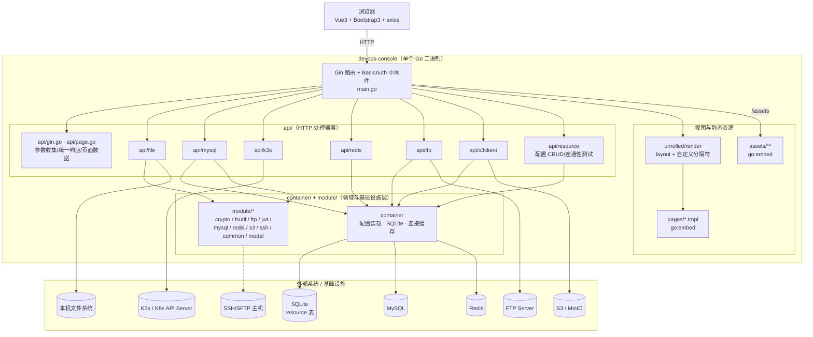
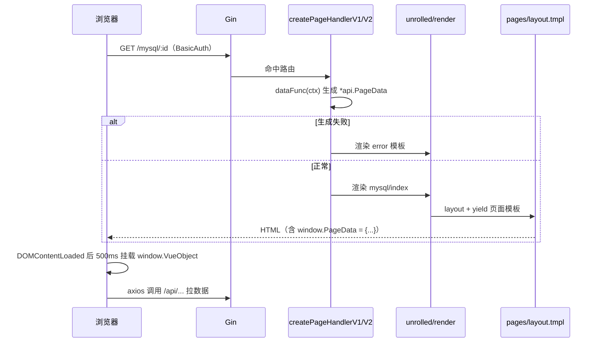
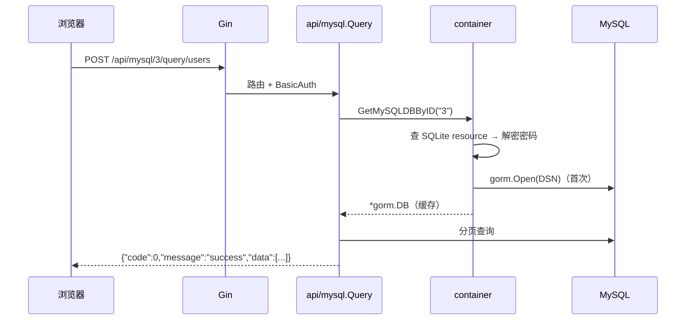

# 01 · 整体架构

## 1. 全景图



## 2. 分层与职责边界

| 层 | 目录 | 职责 | 不应该做的事 |
| --- | --- | --- | --- |
| 入口/路由层 | `main.go` | 读取配置、初始化模板引擎、注册路由与中间件、启动 HTTP Server | 不写业务逻辑 |
| HTTP 处理器层 | `api/**` | 参数解析与校验、调用领域层、统一 JSON 响应、渲染页面数据 | 不直接拼 DSN/不缓存连接 |
| 领域/基础设施层 | `container/`、`module/**` | 配置持久化、连接建立与缓存、密码加解密、协议客户端、归档工具 | 不依赖 Gin（`container` 仅依赖 GORM/Redis/MySQL 驱动） |
| 视图层 | `pages/**`、`assets/**` | 服务端模板骨架 + 前端 Vue 页面；静态 JS/CSS | 不含业务后端逻辑 |
| 外部系统 | MySQL/Redis/FTP/S3/K8s/本机 FS | 被访问的目标 | — |

### 依赖方向

```
main.go ──> api/* ──> api（公共工具）
                 └──> container ──> module/crypto
                 └──> module/*
module/* ──> 第三方 SDK（互不依赖）
```

不存在 `container -> api` 或 `module -> api` 的反向依赖；`api/gin.go`、`api/page.go` 是被各处理器共用的最小公共层。

## 3. 目录结构（带注释）

```text
.
├── main.go                     # 入口：配置初始化、embed、路由注册、模板引擎
├── go.mod / go.sum             # 模块与依赖锁定
├── .env.example                # 环境变量样例（含大量历史变量，见 06 文档）
├── container/                  # 应用容器层
│   ├── entry.go                # AppConfig、InitAppConfig、GetSQLiteDB
│   ├── sqlite.go               # SQLite 打开/迁移、Resource 模型与 CRUD
│   └── resource.go             # 连接缓存（MySQL/Redis）、配置查询、密码解密
├── module/                     # 无框架依赖的基础能力
│   ├── common/                 # map/反射取值、环境变量
│   ├── crypto/                 # AES-GCM、MD5/SHA1、Base64
│   ├── fsutil/                 # zip/tar、目录遍历、文件映射
│   ├── ftp/                    # FTPClient 封装（prefix 语义）
│   ├── jwt/                    # JWT 生成/解析（当前未被引用）
│   ├── model/                  # 「库#表」强类型模型注册表（当前未被引用）
│   ├── mysql/                  # GORM 辅助、DESC/索引、条件构造器
│   ├── redis/                  # Redis 客户端构造（当前未被引用）
│   ├── s3/                     # S3 客户端、STS 临时凭证
│   └── ssh/                    # SSH 命令/SFTP 上传/远程文件（当前未被 HTTP 层引用）
├── api/                        # HTTP 处理器
│   ├── gin.go                  # 参数收集、Success/Failure、JSONResponse
│   ├── page.go                 # PageData/Breadcrumb/DataFunc
│   ├── file/                   # 本机文件管理（12 个 handler）
│   ├── mysql/                  # MySQL 浏览（15 个文件）
│   ├── k3s/                    # K8s/K3s 运维（13 个文件）
│   ├── redis/query.go          # Redis 浏览
│   ├── ftp/                    # FTP 管理（7 个文件）
│   ├── s3client/               # S3 浏览（8 个文件）
│   └── resource/               # 资源配置 CRUD + 测试（define/list/save/test/types）
├── pages/                      # 服务端模板（.tmpl）+ 历史页面元数据（.json）+ 示例 YAML
└── assets/                     # 前端静态资源（Bootstrap/Vue/axios/JSONEditor/...）
```

## 4. 两种典型请求链路

### 4.1 页面请求（服务端渲染外壳 + 前端 Vue 接管）



要点：
- `layout.tmpl` 提供 HTML 骨架、公共 CSS/JS、面包屑、`<div id="app">` 与 `{[{ yield }]}`。
- 页面模板定义 `<template id="template">` 与 `window.VueObject`；`layout` 在 DOM 就绪 500ms 后 `Vue.createApp(...).mount("#app")`。
- 服务端只注入 `window.PageData`（`PageData.Extension`），其余数据均由前端 axios 获取。

### 4.2 API 请求（统一 JSON 包络）



所有 API 的返回统一为：

```json
{ "code": 0, "message": "success", "data": ... }
```

`code != 0` 表示业务失败，HTTP 状态码仍是 200（下载/zip 类接口除外）。

## 5. 配置与启动生命周期

```mermaid
flowchart LR
    A[main] --> B[container.InitAppConfig]
    B --> C[caarlos0/env 解析 AppConfig]
    C --> D[OpenDB SQLITE_PATH]
    D --> E[AutoMigrate Resource]
    B --> F[ENV=develop?]
    F -->|是| G[模板/静态资源读本地文件]
    F -->|否| H[模板/静态资源用 go:embed]
    G/H --> I[注册路由 + BasicAuth]
    I --> J[router.Run(:PORT)]
```

- `InitAppConfig` 失败直接 `panic`（打印 `init app config error`）。
- SQLite 文件所在目录不存在会自动创建（`OpenDB` 中 `os.MkdirAll`）。
- 生产模式下 `assets` 通过 `fs.Sub` + `router.StaticFS` 提供；开发模式下 `router.Static("/assets", "./assets")`。

## 6. 关键设计决策

| 决策 | 原因/效果 | 位置 |
| --- | --- | --- |
| 资源连接配置存 SQLite，而不是环境变量 | 支持运行时增删改、多套环境并存；环境变量只保留应用自身配置 | `container/sqlite.go` |
| 密码统一 AES-GCM 加密后入库 | 避免明文落盘；同一明文每次密文不同（随机 nonce） | `module/crypto/aes.go` |
| 连接对象按“配置 ID”缓存 | 避免每次请求建立连接；配置变更后失效 | `container/resource.go` |
| 模板分隔符改为 `{[{ }]}` | 避免与 Vue 的 `{{ }}` 插值冲突 | `main.go` `newRenderClient` |
| 页面数据通过 `window.PageData` 注入 | 前端无需额外请求即可拿到页面上下文（如 config_id、database） | `main.go` `pageBinding` |
| 单集群 K8s 客户端单例 + 动态客户端处理 CRD | 简化实现；Traefik IngressRoute 兼容两套 API Group | `api/k3s/get.go` |
| 页面/静态资源 embed | 单文件分发；开发模式可热加载本地文件 | `main.go` |

## 7. 依赖矩阵（direct dependencies）

| 领域 | 依赖 | 版本 | 实际使用位置 |
| --- | --- | --- | --- |
| Web 框架 | `github.com/gin-gonic/gin` | v1.9.1 | `main.go`、全部 `api/**` |
| 模板渲染 | `github.com/unrolled/render` | v1.6.1 | `main.go` |
| 环境变量 | `github.com/caarlos0/env/v11` | v11.4.1 | `container/entry.go` |
| .env 加载 | `github.com/joho/godotenv` | v1.5.1 | `container/entry.go`（autoload） |
| ORM/SQLite | `gorm.io/gorm`、`github.com/glebarez/sqlite` | v1.25.7 / v1.11.0 | `container/**` |
| MySQL | `gorm.io/driver/mysql`、`github.com/go-sql-driver/mysql` | v1.5.2 / v1.7.0 | `container/resource.go`、`module/mysql`、`api/resource/test.go` |
| Redis | `github.com/go-redis/redis/v8` | v8.11.4 | `container/resource.go`、`api/redis` |
| FTP | `github.com/jlaffaye/ftp` | v0.2.0 | `module/ftp`、`api/ftp`、`api/resource/test.go` |
| SSH/SFTP | `golang.org/x/crypto`、`github.com/pkg/sftp` | v0.36.0 / v1.13.7 | `module/ssh` |
| S3/STS | `aws-sdk-go-v2`（`config`/`credentials`/`service/s3`/`service/sts`） | 1.41.0 等 | `module/s3`、`api/s3client`、`api/resource/test.go` |
| K8s | `k8s.io/client-go`、`k8s.io/api`、`k8s.io/apimachinery`、`k8s.io/kubectl` | v0.34.1 | `api/k3s` |
| YAML | `sigs.k8s.io/yaml` | v1.6.0 | `api/k3s/get.go` |
| 归档 | `github.com/mholt/archiver/v4` | v4.0.0-alpha.7 | `module/fsutil` |
| JSON 路径 | `github.com/tidwall/gjson` | v1.16.0 | `module/fsutil` |
| JWT | `github.com/golang-jwt/jwt/v5` | v5.3.1 | `module/jwt`（未被引用） |

存在但当前源码未 import 的 direct dependency（历史遗留，可评估移除）：`go-resty/resty/v2`、`nsqio/go-nsq`、`robfig/cron/v3`、`shirou/gopsutil/v4`、`speps/go-hashids`、`sirupsen/logrus`、`codingconcepts/env`。

## 8. 与外部系统的连接方式

| 系统 | 连接从哪里来 | 是否解密密码 | 备注 |
| --- | --- | --- | --- |
| SQLite | `SQLITE_PATH`（默认 `./devops-console.db`） | — | 启动时 AutoMigrate |
| MySQL | `resource(config_type=mysql)` → `container.GetMySQLDBByID` | 是 | GORM，DSN 带 10s 连接、30s 读写超时 |
| Redis | `resource(config_type=redis)` → `container.GetRedisClientByID` | 是 | Ping 成功才缓存 |
| FTP | `resource(config_type=ftp)` → `api/ftp.GetFtpClient` | 否（缺陷，见 06 文档） | 使用 `jlaffaye/ftp`，prefix 由客户端自动拼接 |
| S3 | `resource(config_type=s3)` → `api/s3client.GetS3Client` | 否（缺陷） | `S3Config` 字段与写入的 `ConnectionConfig` 不一致 |
| K8s | `KUBE_CONFIG` 文件路径；为空则 `rest.InClusterConfig()` | — | ServiceAccount 权限需覆盖 pods/log、pods/exec、nodes、CRD |
| SSH | 仅 `api/resource/test.go` 连通性测试使用 | 是 | 未暴露 SSH 业务 API（路由已注释） |
