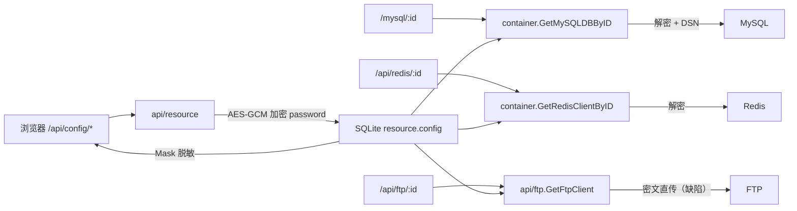

# 05 数据模型与安全

项目唯一的持久化存储是**一个 SQLite 文件**，只存资源配置（`resource` 表）；业务数据（MySQL、Redis、S3、K8s）全部按请求实时透传，不做本地落库或缓存。

## 1. 存储初始化

[container.InitAppConfig](file:///workspace/container/entry.go#L27-L39) 在启动时读取环境变量并打开 SQLite：

```go
type AppConfig struct {
    Port          int64  `env:"PORT" envDefault:"8080"`
    LoginPassword string `env:"LOGIN_PASSWORD"`
    SQLitePath    string `env:"SQLITE_PATH" envDefault:"./devops-console.db"`
    Env           string `env:"ENV"`
}
```

[OpenDB](file:///workspace/container/sqlite.go#L16-L32) 的行为：

1. 若 `SQLITE_PATH` 的父目录不存在，按 `0755` 创建。
2. `gorm.Open(sqlite.Open(path))`，日志级别 `Warn`。
3. 对 `Resource` 执行 `AutoMigrate`（只建表/加列，不做删除或改类型）。
4. 驱动为 `github.com/glebarez/sqlite`（纯 Go），因此**编译不需要 CGO**，交叉编译方便。

SQLite 默认无 WAL、无 busy timeout 配置，写操作串行。适合单实例、低并发场景；多副本部署共享同一文件会锁冲突。

## 2. `resource` 表

模型定义见 [container.Resource](file:///workspace/container/sqlite.go#L93-L107)：

| 列 | Go 类型 | 约束 | 说明 |
| --- | --- | --- | --- |
| `id` | `uint` | 主键、自增 | 资源 ID，即 API 路径中的 `:id` |
| `name` | `string` | `varchar(128)`、非空、联合唯一索引 | 展示名称 |
| `config_type` | `string` | `varchar(32)`、非空、联合唯一索引 | `mysql` / `ftp` / `ssh` / `s3` / `redis` |
| `config` | `string` | `text`、非空、默认 `'{}'` | 连接参数 JSON（密码为密文） |
| `create_timestamp` | `time.Time` | `autoCreateTime` | 创建时间 |
| `update_timestamp` | `time.Time` | `autoUpdateTime` | 更新时间 |

联合唯一索引 `uk_config_type_name(name, config_type)`：**同类型下名称不可重复**，不同类型可同名（如 MySQL 和 Redis 都能叫 `prod`）。冲突时 [friendlyDbError](file:///workspace/api/resource/save.go#L143-L149) 把底层错误翻译为“同名配置已存在”。

表名固定为 `resource`（[TableName](file:///workspace/container/sqlite.go#L104-L107)）。

### 2.1 配置 JSON：两种视图

`config` 列的写入由 [buildResource](file:///workspace/api/resource/define.go#L197-L229) 构造 `ConnectionConfig` 完成，**所有类型共用一套扁平字段**：

| JSON 字段 | 出现类型 | 说明 |
| --- | --- | --- |
| `host` | mysql/ftp/ssh/s3/redis | S3 存 Endpoint，AWS 官方可空 |
| `port` | mysql/ftp/ssh/redis | 未填时落类型默认值（3306/21/22/6379），S3 为 0 |
| `username` | 全部 | S3 存 AccessKey |
| `password` | 全部 | **AES-GCM 密文**，S3 存 SecretKey |
| `database` | mysql | 库名 |
| `prefix` | ftp | 文件管理根目录 |
| `region` | s3 | 默认 `us-east-1` |
| `bucket` | s3 | 默认桶（可选） |
| `db` | redis | 库编号，0 时因 `omitempty` 不落盘 |

`omitempty` 决定了空值字段不会出现在 JSON 中；[ConnectionConfig.Extra](file:///workspace/container/sqlite.go#L72-L91) 反向把这些扩展字段还原给前端。

写入侧的 `Extra` 映射由 [SetExtra](file:///workspace/container/sqlite.go#L54-L70) 完成，且 `normalizeExtra` 只保留该类型 [TypeMetas](file:///workspace/api/resource/define.go#L52-L118) 中声明过的 key，未知 key 被丢弃。

### 2.2 读取侧的强类型结构体

`container` 里另有一套按类型定义的结构体（[MySQLConfig / FTPConfig / SSHConfig / S3Config / RedisConfig](file:///workspace/container/sqlite.go#L176-L218)），通过泛型 [decodeConfig](file:///workspace/container/sqlite.go#L220-L230) 解析同一份 JSON：

| 结构体 | 字段 |
| --- | --- |
| `MySQLConfig` | host, port, username, password, database |
| `FTPConfig` | host, port, username, password, prefix |
| `SSHConfig` | host, port, username, password |
| `S3Config` | access_key, secret_key, region, bucket, endpoint |
| `RedisConfig` | host, port, username, password, db |

**S3 存在结构性不一致**：写入侧存的是 `host/username/password`，读取侧 `S3Config` 期望 `access_key/secret_key/endpoint`，因此 `QueryS3Config` 解出来的凭据恒为空；同时 `GetS3Client` / `GetSTSClient` 也没有做密码解密。S3 相关接口目前实际不可用。

## 3. 密码的加密与脱敏

### 3.1 算法

[crypto.AESGCMEncrypt / AESGCMDecrypt](file:///workspace/module/crypto/aes.go)：

- 密钥：`SHA-256(CONFIG_SECRET)` 派生 32 字节，任意长度密钥都能用。
- 算法：AES-256-GCM，随机 12 字节 nonce（`crypto/rand`）。
- 存储格式：`base64(nonce || ciphertext || tag)`。
- 空字符串直接返回空，不做加解密。
- 无密钥版本号/轮换机制：`CONFIG_SECRET` 一旦更换，历史密文全部无法解密（`.env.example` 中也有该提示）。

`ConfigSecret()` 读取环境变量 `CONFIG_SECRET`，**未设置时回退到硬编码 `devops-console-default-secret`**（[container/resource.go](file:///workspace/container/resource.go#L25-L31)）。生产环境必须显式设置。

### 3.2 生命周期

| 阶段 | 行为 | 位置 |
| --- | --- | --- |
| 创建 | `password` 非空 → 加密后写入 `config` | [Create](file:///workspace/api/resource/save.go#L35-L42) |
| 更新 | `password` 为空 → 沿用旧密文；非空 → 重新加密 | [Update](file:///workspace/api/resource/save.go#L86-L100) |
| 列表/详情 | 只返回 `has_password: bool`，**不回传密文或明文** | [Mask](file:///workspace/api/resource/define.go#L161-L178) |
| 连通性测试 | 先解密再握手 | [Test](file:///workspace/api/resource/test.go#L41-L50) |
| MySQL 连接 | `GetMySQLDBByID` 解密后拼 DSN | [resource.go](file:///workspace/container/resource.go#L93-L97) |
| Redis 连接 | `GetRedisClientByID` 解密后建客户端 | [resource.go](file:///workspace/container/resource.go#L61-L65) |
| FTP / SSH / S3 业务接口 | **未解密**，直接把密文当密码使用 | `api/ftp/base.go`、`api/ssh/*`（路由已注释）、`api/s3client/base.go` |

`Test` 接口对所有类型都正确解密，所以“测试连接成功”不代表页面能用——FTP/S3 页面必然登录失败。

### 3.3 连通性测试的实现

[testByType](file:///workspace/api/resource/test.go#L76-L94) 统一 5 秒超时：

| 类型 | 动作 | 备注 |
| --- | --- | --- |
| MySQL | `sql.Open` + `PingContext` | 用 `mysql.NewConfig()` 取驱动默认值，保留 `mysql_native_password` 支持 |
| FTP | `ftp.Dial` + `Login` | `DialWithTimeout(5s)` |
| SSH | `ssh.Dial` + `Close` | `HostKeyCallback: InsecureIgnoreHostKey()` |
| S3 | `ListBuckets` | 支持自定义 Endpoint；`InsecureSkipVerify: true` |
| Redis | `PING` | 支持 Redis 6 ACL 用户名 |

返回结构：`{id, ok, message, cost_ms, tested_at}`。失败也走 `code=0`，由 `ok=false` 表达。

## 4. 连接缓存

[container/resource.go](file:///workspace/container/resource.go#L19-L23) 维护两个全局 map，key 为资源 ID 字符串：

```go
var (
    clientLock sync.Mutex
    gormMap    = map[string]*gorm.DB{}
    redisMap   = map[string]*redisV8.Client{}
)
```

| 行为 | 说明 |
| --- | --- |
| 首次访问 | 查 SQLite → 解密 → 建连接（MySQL 不 Ping，Redis 会 Ping）→ 入 map |
| 并发 | 全局 `sync.Mutex` 串行化建连，避免重复连接 |
| 失效 | 配置更新/删除时调用 [ClearClientCache](file:///workspace/container/resource.go#L34-L47)，关闭并删除对应条目 |
| 容量 | 无上限、无空闲回收、无健康检查；进程重启才整体失效 |
| 失败 | 建连失败**不缓存**，下次请求重试；Redis 失败返回 `nil`，调用方需自行判空 |

注意 Redis：`GetRedisClientByID` 返回的是共享实例，但 `api/redis/query.go` 在使用后 `defer client.Close()`，会把缓存里的客户端关掉，后续请求拿到已关闭的连接。这是一个实际缺陷（详见 [06-build-run-deploy.md](06-build-run-deploy.md#7-已知缺陷与待清理项)）。

## 5. 鉴权与访问控制

### 5.1 BasicAuth 全站拦截

[main.go](file:///workspace/main.go#L73-L75)：

```go
router.Use(gin.Recovery(), gin.Logger(), gin.BasicAuth(gin.Accounts{
    "admin": appConfig.LoginPassword,
}))
```

| 特性 | 现状 |
| --- | --- |
| 用户名 | 固定 `admin`（`LOGIN_USER` 环境变量**不生效**） |
| 密码 | `LOGIN_PASSWORD`，未设置时为空字符串（等于无有效密码，但 BasicAuth 仍要求提供凭据） |
| 覆盖范围 | 所有路由，包括 `/assets/*` 静态资源 |
| 传输安全 | 明文 Base64，必须靠外层 HTTPS/反向代理保护 |
| 会话 | 无 Cookie、无 Session、无 JWT；`module/jwt` 已实现但**没有任何调用方** |
| 权限模型 | 无角色/租户隔离，任何登录者可操作全部资源 |
| CSRF | 无防护；依赖 BasicAuth 的浏览器自动携带特性，存在跨站请求风险 |

前端 `pages/user/login.tmpl` 与 `/api/user/login` 均为历史遗留，不参与当前鉴权。

### 5.2 登录页与 JWT 的残留

- `module/jwt/jwt.go` 读取 `JWT_SECRET`、`JWT_EXPIRE_HOURS`，可签发/校验 token。
- `main.go` 中没有任何路由引用它，`.env.example` 的 `TOKEN_KEY`、`COOKIE_DOMAIN`、`LOGIN_USER` 同样未被读取。
- 结论：鉴权链路是“BasicAuth 一层”，JWT 代码属于未启用的半成品。

## 6. 安全风险清单

| # | 风险 | 位置 | 影响 |
| --- | --- | --- | --- |
| 1 | 默认加密密钥硬编码 | `container/resource.go#L25-L31` | 未配置 `CONFIG_SECRET` 时，拿到数据库即可解密所有密码 |
| 2 | FTP/S3 业务接口不解密密码 | `api/ftp/base.go#L28-L39`、`api/s3client/base.go#L16-L31` | 功能不可用；若改为明文存储则退化为明文凭据 |
| 3 | S3 字段不一致 | `container.S3Config` vs `ConnectionConfig` | 凭据读取为空，且可能掩盖配置错误 |
| 4 | 任意 SQL 执行 | `POST /api/mysql/:id/exec_sql` | 登录用户可对目标库执行任意语句（含 DDL/DML） |
| 5 | SQL 拼接风险 | `mysql.BuildQueryRaws`：`where` 的 key 直接拼进 `LIKE`/条件，表名来自 URL | 表名/列名可注入；值虽参数化，但标识符未校验 |
| 6 | 任意路径文件操作 | `api/file/*`：`dir`、`file`、`name` 参数 | 可读写进程有权限的任意路径；`mkdirall`/`rename` 可越权 |
| 7 | 容器内命令执行 | `api/k3s/exec`、`api/k3s/log` | 等价于集群内 shell，权限取决于 ServiceAccount |
| 8 | 忽略主机密钥 | `ssh.InsecureIgnoreHostKey()` | 易受中间人攻击 |
| 9 | 忽略 TLS 校验 | S3 测试与客户端 `InsecureSkipVerify: true` | 无法验证对象存储身份 |
| 10 | `LOGIN_PASSWORD` 可空 | `AppConfig` 无默认值/无校验 | 配置遗漏时鉴权形同虚设 |
| 11 | 无 CSRF/审计 | 全局 | 无法追溯谁执行了危险操作 |
| 12 | 静态资源也需认证 | `router.Use(BasicAuth)` | 所有资源请求都带凭据，增大泄露面 |
| 13 | 错误信息直出 | 多处 `api.Failure(ctx, -1, err.Error())` | 泄露内网地址、驱动版本、SQL 片段 |

## 7. 数据流小结



相关阅读：[02-backend-modules.md](02-backend-modules.md)、[03-api-reference.md](03-api-reference.md)、[06-build-run-deploy.md](06-build-run-deploy.md)。
