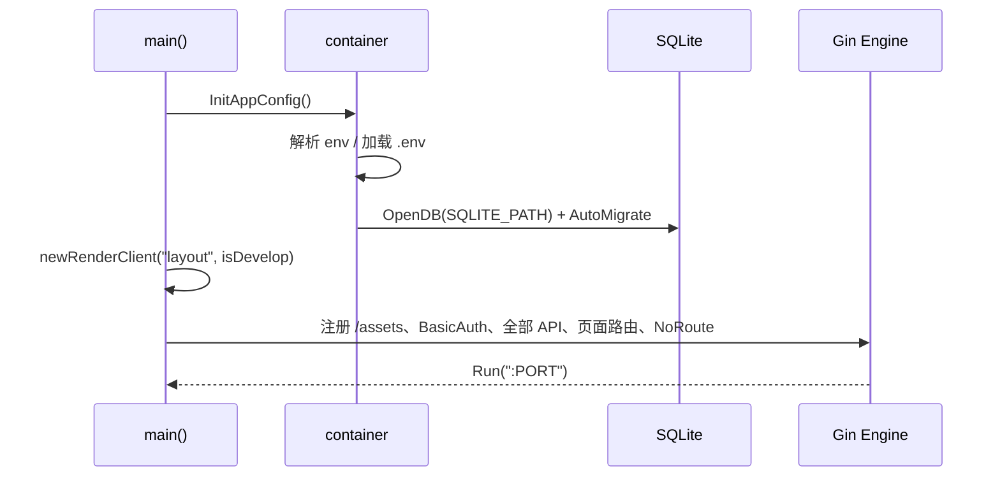

# 06 构建、运行与部署

## 1. 环境要求

| 项 | 要求 | 说明 |
| --- | --- | --- |
| Go | **1.24+**（`go.mod` 声明 `go 1.24.0`） | 本地验证使用 1.25.1，可正常编译 |
| CGO | 不需要 | SQLite 使用 `glebarez/sqlite`（纯 Go），可静态编译 |
| 网络 | 首次构建需拉取模块 | 依赖较多（client-go、aws-sdk-go-v2、archiver 等） |
| 运行时 | 单机 / 容器 / K8s Pod | 需要能访问被管理的 MySQL、Redis、FTP、S3、K3s API |

无前端构建步骤：`pages/` 与 `assets/` 通过 `go:embed` 编进二进制，最终产物是**单文件可执行程序**。

## 2. 环境变量

### 2.1 实际生效的变量

| 变量 | 默认值 | 用途 | 读取位置 |
| --- | --- | --- | --- |
| `PORT` | `8080` | HTTP 监听端口 | `container/entry.go` |
| `LOGIN_PASSWORD` | 空 | BasicAuth 密码（用户名固定 `admin`） | `container/entry.go` + `main.go` |
| `SQLITE_PATH` | `./devops-console.db` | SQLite 文件路径，父目录会自动创建 | `container/entry.go` |
| `ENV` | 空 | `develop` 时模板/静态资源读本地磁盘 | `container/entry.go` |
| `CONFIG_SECRET` | `devops-console-default-secret` | 配置密码的 AES-GCM 密钥 | `container/resource.go` |
| `KUBE_CONFIG` | 空 | kubeconfig 路径；为空时使用 InCluster 配置 | `api/k3s/get.go` |
| `REDIS_ADDR` / `REDIS_USERNAME` / `REDIS_PASSWORD` | 空 | `module/redis` 的全局单例客户端 | `module/redis/redis.go` |
| `JWT_SECRET` / `JWT_EXPIRE_HOURS` | 空 / `24` | JWT 模块参数（当前无调用方） | `module/jwt/jwt.go` |

`.env` 由 [godotenv/autoload](file:///workspace/container/entry.go#L6) 自动加载；环境变量优先级高于 `.env`。

### 2.2 `.env.example` 中已失效的变量

`ASSET_DIR`、`LOGIN_USER`、`TOKEN_KEY`、`COOKIE_DOMAIN`、`MYSQL_*`、`S3_*`、`FTP_*`、`SSH_NODES`、`APOLLO_*`、`API_AUTH_TOKEN` 在当前代码中**没有任何读取点**——资源配置已改为 SQLite 管理。照抄 `.env.example` 不会报错，但也不会生效。

## 3. 构建

```bash
# 开发构建
go build -o devops-console .

# 发布构建（推荐）
CGO_ENABLED=0 go build -trimpath -ldflags "-s -w" -o devops-console .

# 交叉编译示例
CGO_ENABLED=0 GOOS=linux GOARCH=amd64 go build -trimpath -ldflags "-s -w" -o devops-console-linux-amd64 .
```

本次验证结果：

| 命令 | 结果 |
| --- | --- |
| `go build -o /tmp/devops-console .` | 退出码 0 |
| 产物大小 | 约 135 MB（未裁剪，含调试信息） |
| `go vet` / 单元测试 | 仓库内无测试文件，未执行 |

代码中没有 `make`、`Dockerfile`、CI 配置，构建脚本需自行补充。

## 4. 运行

```bash
# 最小启动
PORT=8874 LOGIN_PASSWORD=change-me CONFIG_SECRET='<随机长字符串>' ./devops-console

# 指定数据库位置
SQLITE_PATH=./data/devops-console.db ./devops-console
```

启动流程：



- 监听地址为 `0.0.0.0:PORT`（`router.Run` 默认）。
- 没有优雅退出：进程收到 SIGTERM 直接结束，SQLite 未显式关闭。
- 没有 `/healthz`、`/metrics`；探活只能请求 `/` 并携带 BasicAuth 头。

### 4.1 访问方式

浏览器打开 `http://<host>:<port>/`，弹出 BasicAuth：

- 用户名：`admin`
- 密码：`LOGIN_PASSWORD`

进入后是资源配置首页，可管理 MySQL / FTP / SSH / S3 / Redis；MySQL 配置行可点进 `/mysql/:id`，右上角有 `/tool/json` 入口。

## 5. 开发模式

```bash
ENV=develop PORT=8874 LOGIN_PASSWORD=admin go run .
```

| 行为 | 生产（`ENV` 非 develop） | 开发（`ENV=develop`） |
| --- | --- | --- |
| 模板 | `go:embed` 的 `pages/` | 磁盘 `./pages` |
| 静态资源 | `go:embed` + `fs.Sub` | `router.Static("./assets")` |
| 修改生效 | 需重新编译 | 改 `.tmpl` / JS / CSS 后刷新浏览器即可 |

注意两点：

1. `render.Options.IsDevelopment` **恒为 `true`**，模板本来就不缓存；开关只决定文件来源。
2. 开发模式依赖进程工作目录下有 `pages/` 与 `assets/`，必须在仓库根目录运行。

## 6. 冒烟验证

以下结果是按本文档命令本地启动后实测（`PORT=18874`，`LOGIN_PASSWORD=admin`）：

| 请求 | 状态码 | 结果 |
| --- | --- | --- |
| `GET /`（带 BasicAuth） | 200 | 渲染 `index` 模板，`<title>首页</title>`，`description` 为“页面不存在” |
| `GET /`（不带认证） | 401 | `WWW-Authenticate: Basic realm="Authorization Required"` |
| `GET /api/config/types` | 200 | 返回 5 种类型元数据 |
| `GET /api/config/list` | 200 | `{"code":0,"message":"success","data":[]}`（新库为空） |
| `GET /tool/json` | 200 | JSON 编辑器页面 |
| `GET /mysql/999` | 200 | 渲染 `error` 模板：“MySQL 配置不存在：999” |
| `GET /ftp/1` | **500** | `html/template: "service/ftp" is undefined` |
| `GET /api/ftp/1/list` | 200/业务错误 | 配置不存在时返回 `code=-1` |

`/ftp/:id`、`/ssh/:id`、`/s3/:id`、`/redis/:id` 四个路由都指向不存在的 `pages/service/*` 模板，访问必然 500。这是仓库现状，不是部署问题。

创建资源的快速验证：

```bash
curl -u admin:change-me -X POST http://127.0.0.1:8874/api/config/create \
  -H 'Content-Type: application/json' \
  -d '{"type":"mysql","name":"local","host":"127.0.0.1","port":3306,"username":"root","password":"root","extra":{"database":"mysql"}}'

curl -u admin:change-me http://127.0.0.1:8874/api/config/list
curl -u admin:change-me -X POST http://127.0.0.1:8874/api/config/test/1
```

## 7. 已知缺陷与待清理项

按影响面排序。前 6 项会直接影响可用性或安全性，建议优先处理。

| # | 问题 | 证据 | 建议 |
| --- | --- | --- | --- |
| 1 | 4 个页面路由指向不存在的模板 | `main.go` 的 `/ftp/:id`、`/ssh/:id`、`/s3/:id`、`/redis/:id` → `service/*`；`pages/service/` 不存在 | 改指向 `ftp/index`、`ssh/file`、`redis/index`、`s3browse/index`，或删除路由 |
| 2 | FTP / S3 业务接口不解密密码 | `api/ftp/base.go`、`api/s3client/base.go` 直接把 `cfg.Password` 传入 | 与 MySQL/Redis 一致，先 `AESGCMDecrypt(ConfigSecret(), ...)` |
| 3 | S3 配置字段两端不一致 | 写入 `host/username/password`，`container.S3Config` 读 `access_key/secret_key/endpoint` | 统一写入/读取结构，或在 `QueryS3Config` 做字段映射 |
| 4 | 前端调用缺少 `:id` | `ftp`、`redis`、`k3s` 页面写死 `/api/ftp/list`、`/api/redis/scan`、`/api/k3s/node/list`，后端路由为 `/api/<type>/:id/...` | 前端拼上当前资源 ID；或后端提供无 ID 的默认资源路由 |
| 5 | 大量历史接口未注册 | `/api/execute/*`、`/api/system/*`、`/api/user/login`、`/api/hashids/*`、`/api/ssh/*`、`/api/project/txtzip/convert`、`/api/http/handle`、`/proxy` | 明确下线页面，或补齐实现 |
| 6 | Redis 缓存客户端被关闭 | `api/redis/query.go` 中 `defer client.Close()` 关闭的是 `container` 缓存的共享实例 | 移除 `Close`，或在 `container` 提供“借用/归还”语义 |
| 7 | `distinct` 路由与 handler 不匹配 | 路由 `POST distinct/:column`，handler 读 `ctx.Param("table")` | 改为读 `column`，表名从请求体取 |
| 8 | `file/zip`、`file/unzip` 逻辑错误 | `zip.go` 的 async 分支误调 `fsutil.Unzip` 且压缩仍同步执行；`unzip.go` 重复执行 | 修正分支与返回值，失败时清理半成品 |
| 9 | `BuildQueryRaws` 标识符拼接 | `where` 的 key、表名来自请求，直接拼 SQL | 白名单校验表名/列名，值继续用占位符 |
| 10 | `exec_sql` 无限制 | `api/mysql/exec_sql.go` | 增加只读模式/语句白名单/审计 |
| 11 | K3s 路由 `:id` 未使用 | 所有 k3s handler 都走单例 clientset | 明确“单集群”设计并删掉 `:id`，或按 ID 管理多集群 |
| 12 | `.env.example` 与代码脱节 | 见 2.2 | 删除失效变量，补 `CONFIG_SECRET`、`KUBE_CONFIG` 说明 |
| 13 | 无测试、无 CI、无 Dockerfile | 仓库根目录仅有 Go 源码与静态资源 | 至少补一个启动冒烟测试与多阶段构建文件 |
| 14 | `module/*` 存在未使用实现 | `jwt`、`redis` 全局单例、`common`、`model` 等无调用方 | 清理或接入 |
| 15 | 依赖中的“僵尸包” | `go.mod` 直接依赖 `resty`、`nsq`、`cron`、`gopsutil`、`hashids`、`logrus`、`codingconcepts/env`，代码无引用 | `go mod tidy` 后确认（注意不要误删仍被间接使用的包） |

## 8. 部署要点

### 8.1 容器化（当前需自建）

仓库没有 Dockerfile。参考多阶段构建：

```dockerfile
FROM golang:1.24-alpine AS build
WORKDIR /src
COPY go.mod go.sum ./
RUN go mod download
COPY . .
RUN CGO_ENABLED=0 go build -trimpath -ldflags "-s -w" -o /out/devops-console .

FROM alpine:3.20
RUN apk add --no-cache ca-certificates tzdata
WORKDIR /app
COPY --from=build /out/devops-console /app/devops-console
VOLUME ["/data"]
ENV PORT=8080 SQLITE_PATH=/data/devops-console.db
EXPOSE 8080
ENTRYPOINT ["/app/devops-console"]
```

**必须挂载卷**到 `SQLITE_PATH` 所在目录，否则容器重建后配置全丢。

### 8.2 Kubernetes

| 关注点 | 要求 |
| --- | --- |
| 副本数 | 建议 `1`（SQLite 单文件，`Recreate` 策略） |
| 持久化 | PVC 挂到 `/data`，`SQLITE_PATH=/data/devops-console.db` |
| 环境变量 | `LOGIN_PASSWORD`、`CONFIG_SECRET` 用 Secret 注入；`PORT` 与 Service 对齐 |
| K3s 权限 | 默认走 InCluster；也可挂 kubeconfig 并设 `KUBE_CONFIG` |
| RBAC | 需要 `get/list/watch/create/update/patch/delete` 于目标资源；`exec`、`pods/log` 用于命令与日志 |
| 探针 | 无健康端点，只能对 `/` 发带 BasicAuth 的 HTTP 探针，或先加 `/healthz` |
| 网络 | 出站需可达被管理的 MySQL/Redis/FTP/S3 与 K8s API；入站建议只暴露给内网 |
| TLS | 应用不自带 HTTPS，需 Ingress/反代终止 TLS，否则 BasicAuth 凭据明文传输 |

K3s 相关功能依赖的集群资源：`nodes`、`pods`、`deployments`、`services`、`ingresses`、`ingressroutes`（Traefik CRD）、`configmaps`、`secrets`、`statefulsets`、`daemonsets`、`jobs`、`cronjobs`、`persistentvolumeclaims` 等，具体别名见 [03-api-reference.md](03-api-reference.md)。

### 8.3 文件权限

`api/file/*` 直接在进程视角操作本机路径。容器内运行时，可操作范围就是容器文件系统 + 已挂载卷；若挂载了宿主机目录，等效于把这些目录的读写权限授予所有登录用户。建议：

- 以非 root 运行；
- 只挂载明确需要的目录；
- 在入口层限制可访问路径前缀（当前代码未做）。

## 9. 排障

| 现象 | 可能原因 | 处理 |
| --- | --- | --- |
| 启动即 panic `open sqlite ...` | 路径不可写 / 目录无法创建 | 检查 `SQLITE_PATH` 权限与挂载 |
| 浏览器反复弹认证框 | `LOGIN_PASSWORD` 为空或含特殊字符 | 显式设置强密码 |
| 页面报 `"service/xxx" is undefined` | 访问了 `/ftp/:id` 等 4 个遗留路由 | 使用 `/` 首页或 `/mysql/:id` |
| `config/test/:id` 成功但页面不可用 | FTP/S3 未解密密码 | 见第 7 节第 2、3 项 |
| K3s 接口 403 | ServiceAccount 权限不足 | 补 RBAC |
| K3s 接口 `no configuration has been provided` | 非集群内运行且未设 `KUBE_CONFIG` | 挂载 kubeconfig 并设置变量 |
| 修改配置后仍连旧库 | 连接缓存未失效 | 确认走 `Update`/`Delete`（会调用 `ClearClientCache`），否则重启进程 |
| 静态资源 404 | 生产包未包含 `assets`，或开发模式工作目录不对 | 重新编译；开发模式在仓库根目录启动 |

相关阅读：[01-architecture.md](01-architecture.md)、[02-backend-modules.md](02-backend-modules.md)、[05-data-and-security.md](05-data-and-security.md)。
